# CodeCompass

**Understand any codebase. Find your way through unfamiliar repositories.**

CodeCompass is a codebase onboarding platform. A developer can import a public GitHub repository, let background workers index and analyze it, then explore its files, parsed code, relationships, and a guided reading path. Natural-language search and repository Q&A help locate relevant code, and Q&A answers include validated references to the retrieved source chunks.

When a developer joins an unfamiliar project, questions such as “Where does the application start?”, “How is authentication handled?”, and “Which files work together?” can take hours to answer. CodeCompass reduces that initial search by organizing source code and providing several ways to navigate it.

The application does not send an entire repository to an LLM and ask for a summary. It first builds a file inventory, extracts selected code structures into chunks, creates local embeddings, and retrieves relevant chunks. Only the question and selected evidence are sent to the configured Gemini API for an answer.

## Contents

- [Screenshots and product walkthrough](#screenshots-and-product-walkthrough)
- [Features and current scope](#features-and-current-scope)
- [System architecture](#system-architecture)
- [Repository processing lifecycle](#repository-processing-lifecycle)
- [Authentication and request security](#authentication-and-request-security)
- [Search and question answering](#search-and-question-answering)
- [Code graph and onboarding guide](#code-graph-and-onboarding-guide)
- [Data model](#data-model)
- [Technology stack](#technology-stack)
- [Local development setup](#local-development-setup)
- [Configuration reference](#configuration-reference)
- [API reference](#api-reference)
- [End-to-end API examples](#end-to-end-api-examples)
- [Testing and troubleshooting](#testing-and-troubleshooting)
- [Security and privacy](#security-and-privacy)
- [Deployment considerations](#deployment-considerations)
- [Limitations and future improvements](#limitations-and-future-improvements)
- [Contributing](#contributing)

## Screenshots and product walkthrough

### 1. Landing page and GitHub sign-in

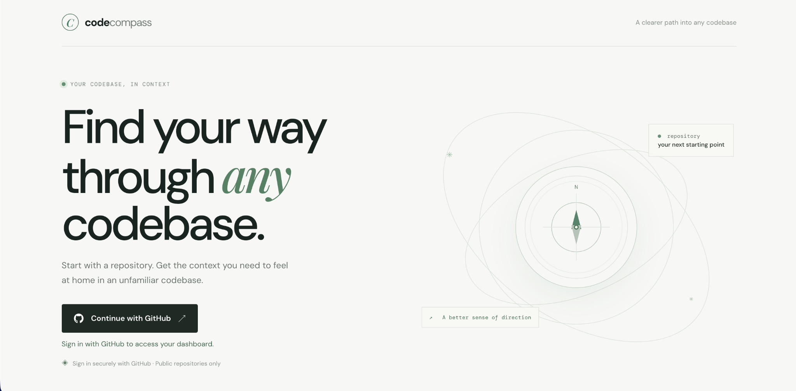

The landing page introduces the product and offers **Continue with GitHub**. GitHub OAuth establishes a CodeCompass session and returns the user to their workspace. The current import flow supports public GitHub repositories.

### 2. Dashboard

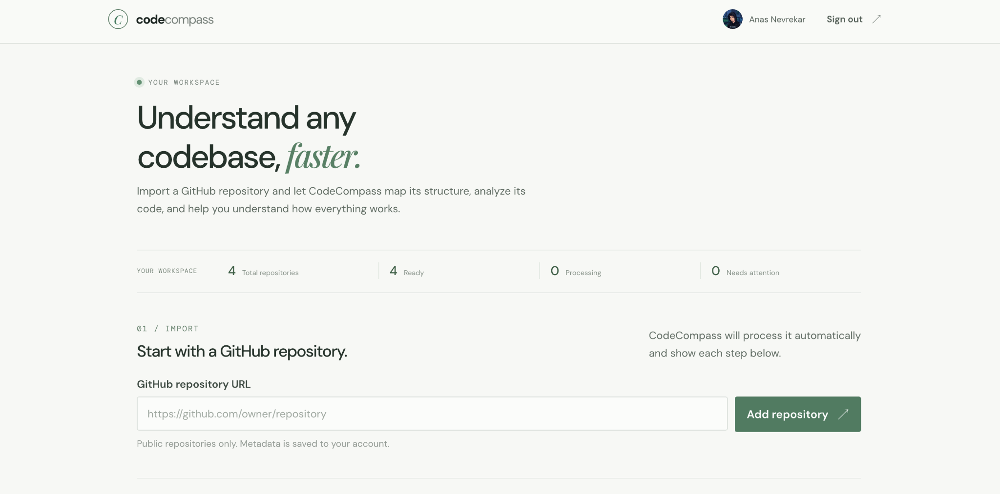

The dashboard is the signed-in user's workspace. It provides a public GitHub repository URL form, a library of imported repositories, and summary counts for total repositories, ready repositories, repositories processing, and repositories needing attention. A repository card links to the repository's analysis tools.

### 3. Repository processing

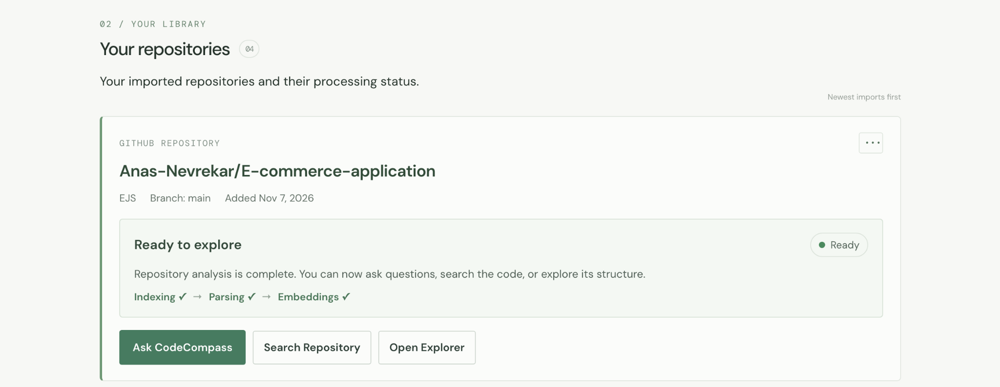

After import, the backend runs indexing, parsing, and embedding generation as background work. The repository card shows the current stage and backend-reported progress. Once processing is ready, the user can ask questions, search code, or open the explorer. A failed stage is reported as needing attention and can be retried where the API exposes a retry action.

### 4. Ask CodeCompass

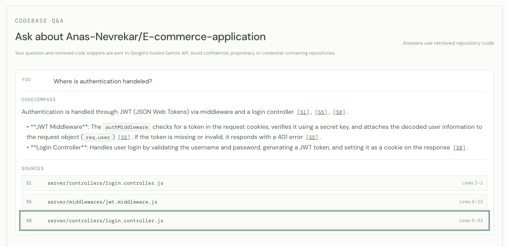

For a question such as “Where is authentication handled?”, CodeCompass retrieves matching code and asks Gemini to explain that evidence. The answer cites source IDs such as `[S1]`; the Sources list shows the trusted path, line range, and expandable source snippet. The backend validates citation IDs before returning them.

### 5. Repository graph

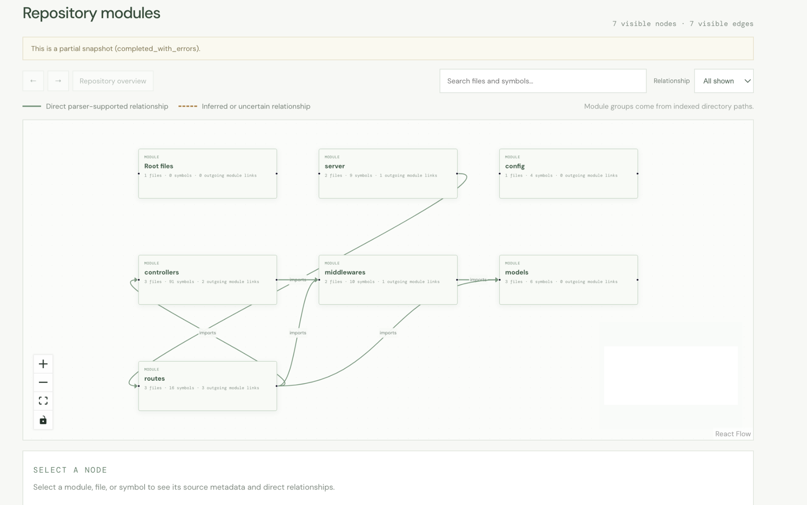

The explorer visualizes indexed directory modules and parser-supported relationships. The current graph starts with path-based module groups and supports navigating into files and symbols. Direct parser-backed relationships and inferred or uncertain relationships are styled differently; the graph API reports when size limits make a result partial.

### 6. Guided onboarding

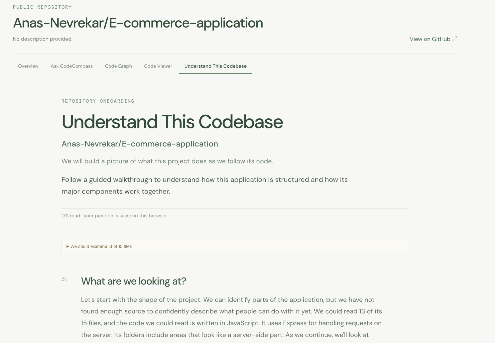

The onboarding guide presents a staged route through repository structure, initialization, application flow, core functionality, data architecture, dependencies, and further exploration. Recommendations are generated from indexed paths, parsed chunks, and resolved imports. Progress is manually updated by the user and stored against the current parse snapshot.

## Features and current scope

- GitHub OAuth sign-in and user-scoped repository imports.
- Public repository metadata import and background source indexing.
- AST-based parsing and code chunk storage for supported languages.
- Local Ollama embedding generation and PostgreSQL vector storage.
- Keyword and vector retrieval combined with Reciprocal Rank Fusion (RRF).
- Gemini-backed, evidence-grounded Q&A with citation validation and optional streaming.
- Repository module graph, parsed-source viewer API, and structured onboarding guide.
- Repository deletion with shared repository ownership handling.

Private repositories, full source-file serving, conversation persistence, and runtime execution analysis are not implemented.

## System architecture

The frontend and backend live in separate repositories/directories. The frontend calls the Express API using credentialed HTTP requests. PostgreSQL stores account, repository, job, code chunk, and embedding metadata. Redis and BullMQ coordinate three worker processes. Cloned repository files are retained on disk for subsequent parsing; vector embeddings are generated by a local Ollama service. Gemini is used only for answer generation.

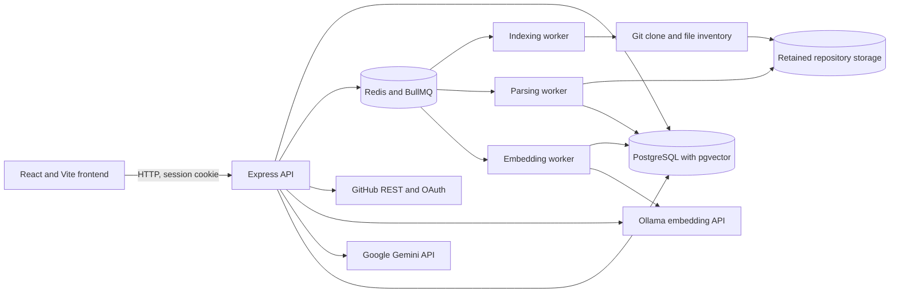

The browser never calls GitHub's provider APIs for repository import, Ollama, or Gemini directly. Provider credentials stay in the backend environment.

## Repository processing lifecycle

Importing a repository creates or reuses shared repository metadata and attaches it to the signed-in user. A new import automatically starts indexing. After successful indexing, the pipeline queues parsing; after a successful parse with no failed files, it automatically queues embedding work. The embeddings endpoint remains available for an explicit retry or to start a job where needed.

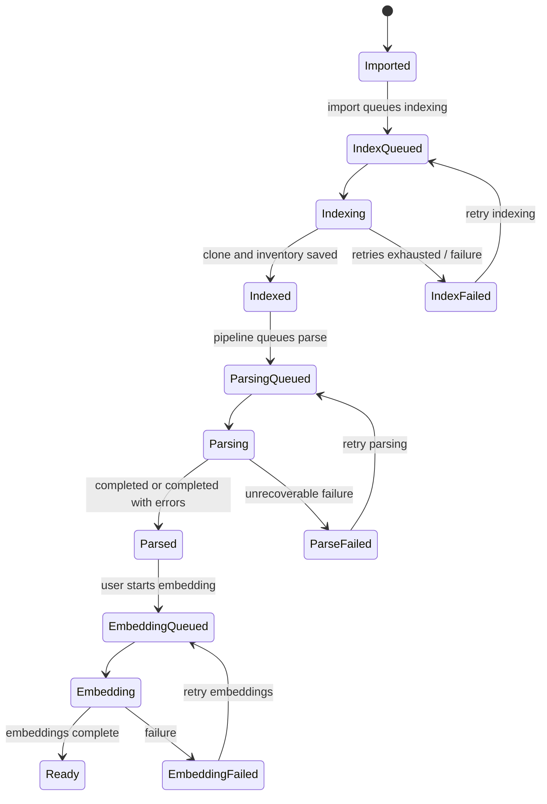

### Indexing

The indexing worker shallow-clones the selected public repository revision, applies file discovery and eligibility rules, and stores a file inventory tied to an indexing job. It retains the successful clone so the parsing worker can read source files. Repository size, file size, clone timeout, worker concurrency, and temporary storage cleanup are configurable. Indexing jobs use BullMQ retries (three attempts with exponential backoff starting at one second).

### Parsing

The parsing worker reads eligible files from retained storage and uses Tree-sitter parsers for JavaScript, TypeScript, and Python. It persists chunks such as functions, classes, variables, and imports with source text, path, language, structure type, line range, metadata, and a source hash. Individual unsupported or unreadable files may be skipped or fail while the job completes with partial results. Parsing progress and per-file outcomes are persisted in PostgreSQL.

### Embeddings

The embedding worker batches parsed chunks and calls the configured Ollama `/api/embed` endpoint. The default model is `qwen3-embedding:0.6b`, configured for 1024 dimensions. Vectors are stored in PostgreSQL's `vector(1024)` column. Unchanged chunks can reuse existing vectors when the source hash and embedding configuration match. A completed embedding job for the current parse is needed for the dashboard to consider the repository ready for search and Q&A.

### Queue and worker flow

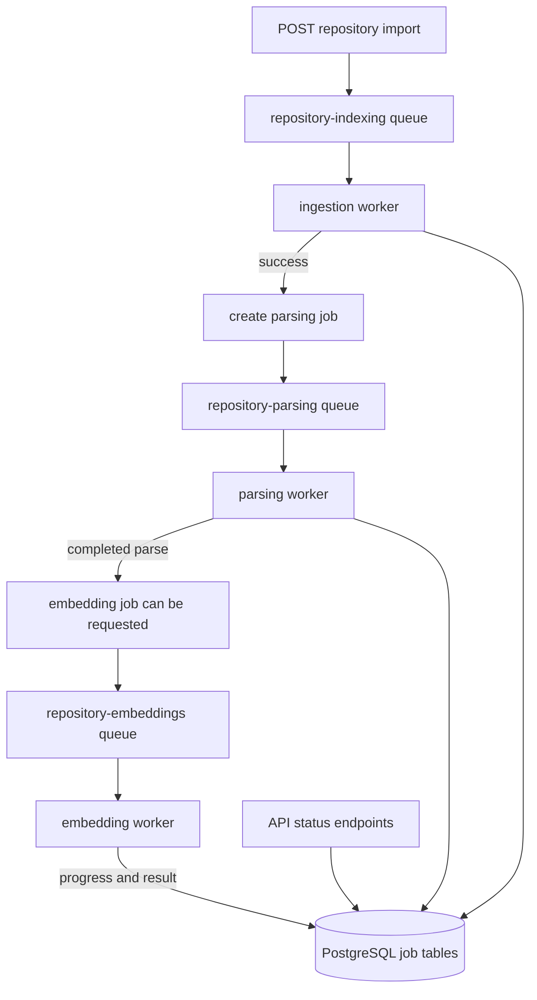

The backend `npm run dev` command starts the API plus the indexing, parsing, and embedding workers. The individual commands remain available for isolated development. Redis must be running for BullMQ queues. Startup recovery logic is implemented in the workers for interrupted processing state; specific retry behavior depends on the queue and persisted job state.

## Authentication and request security

1. The browser navigates to `GET /api/auth/github`.
2. The backend creates and verifies OAuth state, then redirects to GitHub.
3. The callback exchanges the authorization code, fetches the GitHub profile, and upserts the CodeCompass user.
4. The backend discards the GitHub access token after profile lookup, signs a session token, sets an HTTP-only session cookie, and redirects to the frontend.
5. The frontend calls `GET /api/auth/me` on startup. Protected API routes validate the session cookie and resolve the user from PostgreSQL.

```mermaid
sequenceDiagram
  participant U as Browser
  participant A as CodeCompass API
  participant G as GitHub
  participant D as PostgreSQL
  U->>A: GET /api/auth/github
  A-->>U: Redirect to GitHub with OAuth state
  U->>G: Authorize
  G-->>U: Redirect with code and state
  U->>A: GET /api/auth/github/callback
  A->>G: Exchange code and fetch profile
  G-->>A: Profile data
  A->>D: Upsert user
  A-->>U: Set HTTP-only session cookie; redirect to frontend
  U->>A: GET /api/auth/me with cookie
  A->>D: Validate user exists
  A-->>U: Current user
```

State-changing routes also check that the request `Origin` exactly matches `FRONTEND_URL`. Credentialed CORS permits only that configured frontend origin. Authentication and repository ownership are enforced by backend middleware and queries. Auth initiation/callback and repository import endpoints have rate limits. Error responses use a safe `{ "error": { "code", "message" } }` envelope.

## Search and question answering

### Hybrid search

Search creates a query embedding with Ollama, performs vector search using PostgreSQL cosine distance, and performs keyword search using PostgreSQL full-text search plus identifier/path substring matching. The two result lists are merged by RRF:

`score = Σ 1 / (k + rank)`

The default `k` is 60. Search runs against the latest completed parse and returns chunk IDs, source, file metadata, line ranges, and retrieval ranks/scores. Search itself does not call Gemini.

### RAG answer generation

Retrieval-Augmented Generation (RAG) means the answer model receives selected repository evidence alongside the question. CodeCompass limits the evidence to its configured context budget and assigns source IDs. The Gemini system prompt treats retrieved source as untrusted data, asks for evidence-based answers, and requires citation references. The backend validates citations and maps them to trusted database chunk metadata before responding. If retrieval yields no evidence, the API returns a clear insufficient-evidence response without inventing repository details.

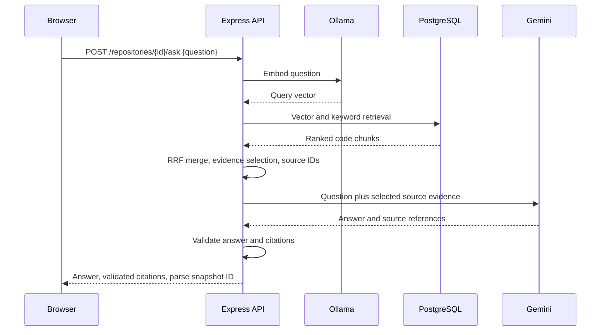

Streaming uses Server-Sent Events over a credentialed `fetch` POST. Events include `start`, `token`, `citations`, `complete`, and `error`. Non-streaming requests return JSON. When no evidence is retrieved, the endpoint returns the insufficient-evidence JSON directly, even if streaming was requested. Conversations are held in frontend page state and are not persisted by the backend.

## Code graph and onboarding guide

The graph and guide are deterministic backend analyses of the current indexed inventory and parsed chunks; they are not generated by Gemini.

- **Graph:** emits file and AST symbol nodes, `CONTAINS` relationships based on parser ranges, and `IMPORTS` relationships when a module path resolves unambiguously. It does not fabricate call, export, inheritance, or implementation edges. Graph output is bounded to 1,000 files and 5,000 chunks and reports truncation.
- **Modules:** group files from indexed directory paths. Group-to-group edges summarize resolved imports; folder names are not interpreted as semantic roles.
- **Source viewer API:** returns selected parsed chunks with trusted path and line metadata. It does not return complete source files; unparsed lines are unavailable.
- **Reading guide:** creates seven ordered stages: repository map, initialization, application flow, core functionality, data architecture, dependencies, and next exploration. Filename and directory hints are labeled as heuristics; parser-backed imports are direct evidence but do not prove runtime order.
- **Progress:** stored per user and repository for a parsing job snapshot. A newer parse makes the earlier progress snapshot no longer current.

## Data model

The Prisma schema is the source of truth. IDs are UUIDs unless noted. Ownership and deletion behavior are enforced through foreign keys and unique constraints.

| Model | Purpose | Important relationships |
|---|---|---|
| `User` | GitHub identity and CodeCompass account | Has repository imports, indexing jobs, and reading progress |
| `Repository` | Shared public GitHub repository metadata and retained-processing state | Has imports, indexing jobs, files, parses, chunks, embeddings, and progress |
| `RepositoryImport` | Associates a user with a repository | Unique per `(userId, repositoryId)`; deleting one import can preserve shared repository data |
| `ReadingProgress` | Per-user guide position and stage status | Unique per `(userId, repositoryId)`; tied to a parse snapshot ID |
| `IndexingJob` | Clone and inventory job status/progress | Belongs to user and repository; cascades to its inventory files and parses |
| `RepositoryFile` | File inventory row for an indexing snapshot | Unique per `(repositoryId, indexingJobId, relativePath)` |
| `ParsingJob` | AST parsing state for an indexing snapshot | Has per-file results and code chunks |
| `ParsingFileResult` | Parsed/skipped/failed result for a file | Unique per `(parsingJobId, fileId)` |
| `CodeChunk` | AST-selected source excerpt with path, lines, and source hash | Belongs to repository, file, and parsing job |
| `EmbeddingJob` | Embedding batch job state and progress | Belongs to repository and parsing job |
| `CodeEmbedding` | Vector plus model/dimension metadata | Unique per `(codeChunkId, embeddingModel, embeddingDimensions)` |

Enums in the schema include `IndexingStatus`, `ParsingStatus`, and `EmbeddingStatus`; job tables retain progress counts, stage, timestamps, and error information. PostgreSQL's `vector(1024)` field is represented as Prisma `Unsupported` and accessed with parameterized raw SQL. See [`prisma/schema.prisma`](prisma/schema.prisma) and the migration history in [`prisma/migrations/`](prisma/migrations/).

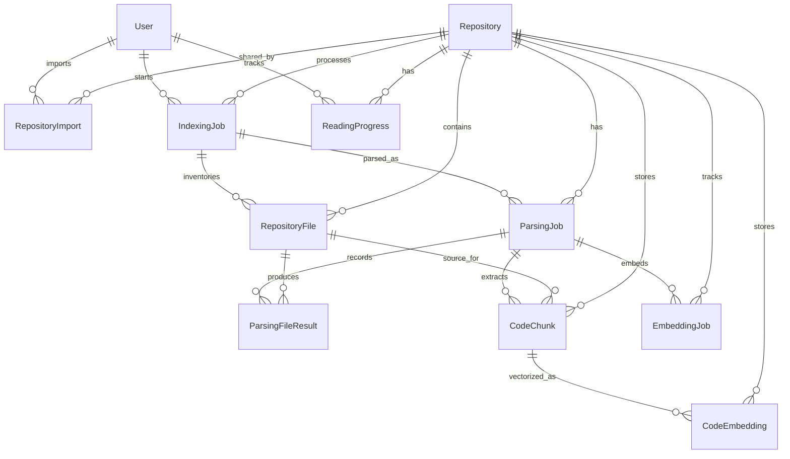

## Technology stack

| Area | Implementation |
|---|---|
| Frontend | React, Vite, React Router, Fetch API |
| Code display and graph | Monaco Editor React integration, React Flow |
| Backend | Node.js 20+, Express 5, ES modules |
| Database | PostgreSQL, Prisma 6, pgvector extension |
| Queues | Redis 7 and BullMQ 5 |
| Parsing | Tree-sitter JavaScript, TypeScript, and Python grammars |
| Embeddings | Ollama `/api/embed`, default `qwen3-embedding:0.6b`, 1024 dimensions |
| Answer generation | Google `@google/genai` SDK, configured Gemini model |
| Tests | Node test runner and Supertest (backend); Vitest and Testing Library (frontend) |

## Local development setup

### Requirements

- Node.js 20 or newer and npm.
- Docker with Docker Compose plugin, for PostgreSQL and Redis.
- Git available on `PATH` for repository cloning.
- A GitHub OAuth App for sign-in.
- Ollama installed and running with `qwen3-embedding:0.6b` for embeddings/search.
- A Gemini API key for repository Q&A.

The two repositories are separate. These instructions assume they are adjacent folders named `codecompass-backend` and `codecompass-frontend`.

### 1. Configure and start the backend

```bash
cd codecompass-backend
npm install
cp .env.example .env
```

Set the required OAuth values in `.env`:

```dotenv
GITHUB_CLIENT_ID=your-oauth-client-id
GITHUB_CLIENT_SECRET=your-oauth-client-secret
GITHUB_CALLBACK_URL=http://localhost:3000/api/auth/github/callback
SESSION_SECRET=replace-with-at-least-32-random-bytes
LLM_API_KEY=your-gemini-api-key
```

Generate a local session secret with `openssl rand -base64 32`. Register an OAuth App with homepage `http://localhost:5173` and callback URL `http://localhost:3000/api/auth/github/callback`.

Start PostgreSQL and Redis, apply migrations, and run the API plus workers:

```bash
docker compose up -d
npm run db:deploy
npm run dev
```

`npm run dev` starts the API and all three workers. Use Ctrl+C to stop them. For isolated debugging, use `npm run dev:api`, `npm run worker`, `npm run parse-worker`, or `npm run embedding-worker` in separate terminals. Do not start duplicate worker processes unless you intend to run additional concurrency.

### 2. Configure and start the frontend

In a second terminal:

```bash
cd codecompass-frontend
npm install
cp .env.example .env
npm run dev
```

The frontend defaults to `http://localhost:5173` and API base `http://localhost:3000`. Backend `FRONTEND_URL` must exactly match the browser origin. Use consistent hostnames (for example, `localhost` for both) so cookies and origin checks match.

### 3. Start Ollama

Install and start Ollama separately, then ensure the model is available:

```bash
ollama pull qwen3-embedding:0.6b
```

The default backend URL is `http://localhost:11434`. Ollama is required for embedding generation and search; Gemini is required for Q&A.

## Configuration reference

Values below are read by the backend from `codecompass-backend/.env`. The frontend reads only `VITE_API_BASE_URL` from its own `.env`. Never put server secrets in variables prefixed with `VITE_`.

| Variable | Default | Purpose |
|---|---|---|
| `NODE_ENV` | `development` | Runtime mode: development, test, or production |
| `PORT` | `3000` | HTTP API port |
| `FRONTEND_URL` | `http://localhost:5173` | Exact allowed frontend origin |
| `DATABASE_URL` | local PostgreSQL URL | PostgreSQL connection string |
| `REDIS_URL` | `redis://localhost:6379` | Redis/BullMQ connection |
| `GITHUB_CLIENT_ID` | empty | OAuth App client ID |
| `GITHUB_CLIENT_SECRET` | empty | OAuth App secret |
| `GITHUB_CALLBACK_URL` | empty | OAuth callback; required for OAuth flow |
| `SESSION_SECRET` | empty | Session signing secret; at least 32 bytes when configured |
| `INDEXING_CLONE_TIMEOUT_MS` | `120000` | Clone timeout |
| `INDEXING_MAX_REPOSITORY_SIZE_MB` | `500` | Repository size ceiling |
| `INDEXING_MAX_FILE_SIZE_MB` | `2` | Eligible source file size ceiling |
| `INDEXING_WORKER_CONCURRENCY` | `2` | Index worker concurrency |
| `INDEXING_TEMP_DIR` | system temp | Temporary clone directory override |
| `INDEXING_REPOSITORY_STORAGE_DIR` | `../codecompass-repository-storage` | Retained successful clone directory |
| `INDEXING_STALE_TEMP_DIR_AGE_HOURS` | `24` | Age threshold for stale temp cleanup |
| `INDEXING_RECOVERY_INTERVAL_MS` | `30000` | Index recovery scan interval |
| `EMBEDDING_PROVIDER` | `ollama` | Only `ollama` is currently accepted |
| `EMBEDDING_BASE_URL` | `http://localhost:11434` | Ollama base URL |
| `EMBEDDING_MODEL` | `qwen3-embedding:0.6b` | Embedding model name |
| `EMBEDDING_DIMENSIONS` | `1024` | Vector dimensions; must match schema column |
| `EMBEDDING_BATCH_SIZE` | `16` | Chunks sent per embedding request |
| `EMBEDDING_MAX_INPUT_CHARS` | `100000` | Max text length accepted per chunk |
| `EMBEDDING_WORKER_CONCURRENCY` | `1` | Embedding worker concurrency |
| `EMBEDDING_REQUEST_TIMEOUT_MS` | `120000` | Ollama request timeout |
| `HYBRID_SEARCH_VECTOR_LIMIT` | `20` | Candidate count from vector search |
| `HYBRID_SEARCH_KEYWORD_LIMIT` | `20` | Candidate count from keyword search |
| `HYBRID_SEARCH_DEFAULT_LIMIT` | `10` | Default result count |
| `HYBRID_SEARCH_RRF_K` | `60` | RRF rank constant |
| `LLM_PROVIDER` | `gemini` | Only `gemini` is currently accepted |
| `LLM_API_KEY` | empty | Gemini key; required for Q&A |
| `LLM_MODEL` | `gemini-3.8-flash` | Configured Gemini model ID |
| `LLM_MAX_OUTPUT_TOKENS` | `1500` | Generation output limit |
| `LLM_REQUEST_TIMEOUT_MS` | `60000` | Gemini request timeout |
| `RAG_RETRIEVAL_LIMIT` | `10` | Chunks retrieved for an answer |
| `RAG_MAX_CONTEXT_TOKENS` | `12000` | Approximate evidence context budget |
| `RAG_MAX_QUESTION_LENGTH` | `2000` | Maximum question length |
| `RAG_ENABLE_STREAMING` | `true` | Enable SSE answer requests |
| `VITE_API_BASE_URL` | `http://localhost:3000` | Frontend API origin |

The `.env.example` files and `src/config/env.js` are authoritative. The sample also contains `POSTGRES_DB`, `POSTGRES_USER`, `POSTGRES_PASSWORD`, and optional `POSTGRES_PORT` / `REDIS_PORT` values used by Docker Compose.

## API reference

All routes are prefixed with `/api`. Unless noted, API endpoints require a valid CodeCompass session cookie and enforce repository ownership. State-changing requests require the configured frontend `Origin`. JSON errors use `{ "error": { "code": "...", "message": "..." } }`.

### Health

| Method | Path | Auth | Purpose |
|---|---|---:|---|
| `GET` | `/health` | No | Liveness: API process responds |
| `GET` | `/ready` | No | Checks database and Redis readiness |

### Authentication

| Method | Path | Auth | Purpose |
|---|---|---:|---|
| `GET` | `/auth/github` | No | Start GitHub OAuth; browser navigation |
| `GET` | `/auth/github/callback` | OAuth state | OAuth callback; sets session and redirects |
| `GET` | `/auth/me` | Yes | Return current signed-in user |
| `POST` | `/auth/logout` | Origin | Clear session cookie |

### Repositories and processing

| Method | Path | Auth | Purpose |
|---|---|---:|---|
| `POST` | `/repositories/import` | Yes + Origin | Import public GitHub URL and automatically queue indexing |
| `GET` | `/repositories` | Yes | List repositories imported by current user |
| `DELETE` | `/repositories/:repositoryId` | Yes + Origin | Remove user's import; deletes shared processing data if last owner |
| `POST` | `/repositories/:repositoryId/index` | Yes + Origin | Start/retry indexing; returns `202` for newly queued, `200` when already active |
| `GET` | `/repositories/:repositoryId/indexing-status` | Yes | Return latest indexing/parsing/embedding stage summaries |
| `GET` | `/indexing-jobs/:jobId` | Yes | Read an owned indexing job |
| `POST` | `/repositories/:repositoryId/parse` | Yes + Origin | Start or retry parsing |
| `GET` | `/parsing-jobs/:jobId` | Yes | Read parsing progress |
| `POST` | `/repositories/:repositoryId/embeddings` | Yes + Origin | Start embedding generation for available parse |
| `GET` | `/embedding-jobs/:jobId` | Yes | Read embedding progress |
| `GET` | `/embeddings/health` | Yes | Check configured Ollama embedding service/model availability |

### Search, Q&A, and explorer

| Method | Path | Auth | Purpose |
|---|---|---:|---|
| `POST` | `/repositories/:repositoryId/search` | Yes + Origin | Hybrid vector/keyword search |
| `POST` | `/repositories/:repositoryId/ask` | Yes + Origin | RAG question answering; JSON or SSE |
| `GET` | `/repositories/:repositoryId/graph` | Yes | Repository graph from latest parse |
| `GET` | `/repositories/:repositoryId/reading-guide` | Yes | Static-analysis onboarding guide |
| `GET` | `/repositories/:repositoryId/reading-progress` | Yes | Read user's guide progress |
| `PUT` | `/repositories/:repositoryId/reading-progress` | Yes + Origin | Save progress for current parsing snapshot |
| `GET` | `/repositories/:repositoryId/source` | Yes | Read parsed chunk snippets by file/line/symbol/chunk |

### Selected request and response shapes

**Import** — request `{ "url": "https://github.com/owner/repository" }`. Returns `success`, import status, repository metadata, and processing state where applicable.

**Search** — request `{ "query": "Where is user authentication handled?", "limit": 10 }`. Returns `{ repositoryId, query, parsingJobId, results }`; results include `chunkId`, path, language, AST structure, symbol, line range, source, and retrieval rank metadata.

**Ask** — request `{ "question": "Where is authentication handled?", "stream": false }`. Non-streaming JSON includes `{ repositoryId, question, answer, citations, insufficientEvidence, parsingJobId }`. A citation includes its trusted `chunkId`, path, language, structure, symbol, line range, source, and explanation.

**Graph** — status may be `not_indexed`, `indexing`, `not_parsed`, `parsing`, `failed`, `stale`, or ready. Ready responses include nodes, edges, module groups, support metadata, and truncation/completeness metadata.

**Source** — requires `filePath`; optional query parameters include `startLine`, `endLine`, `symbolName`, and `chunkId`. Returns `{ repositoryId, filePath, contentScope: "parsed_chunks", chunks, metadata }`; `metadata.isCompleteFile` is false because the API retains parsed chunks rather than complete source files.

## End-to-end API examples

The examples assume the browser has already authenticated and has a session cookie. `curl` must preserve that cookie in `cookies.txt`, and state-changing calls must send the exact frontend `Origin`.

### A. Import and check processing

```bash
curl -i -b cookies.txt -c cookies.txt \
  -H 'Origin: http://localhost:5173' -H 'Content-Type: application/json' \
  -d '{"url":"https://github.com/owner/repository"}' \
  http://localhost:3000/api/repositories/import

curl -b cookies.txt http://localhost:3000/api/repositories
curl -b cookies.txt http://localhost:3000/api/repositories/REPOSITORY_UUID/indexing-status
```

A new import automatically queues indexing. The indexing worker records the current inventory and queues parsing after success. Check the current stage and progress with:

```bash
curl -b cookies.txt http://localhost:3000/api/repositories/REPOSITORY_UUID/indexing-status
```

The pipeline automatically queues parsing after indexing and embeddings after a successful parse. Poll the repository status response to follow each stage; if an embedding job must be explicitly (re)started, `POST /api/repositories/REPOSITORY_UUID/embeddings` returns its job ID, which can be polled at `/api/embedding-jobs/JOB_UUID`. IDs above are placeholders.

### B. Search a repository

```bash
curl -b cookies.txt -H 'Origin: http://localhost:5173' \
  -H 'Content-Type: application/json' \
  -d '{"query":"Where is user authentication handled?","limit":10}' \
  http://localhost:3000/api/repositories/REPOSITORY_UUID/search
```

Each result includes the matching `chunkId`, `filePath`, line bounds, source, and vector/keyword ranks plus RRF metadata. Search requires embeddings for the current parse.

### C. Ask a repository question

```bash
curl -b cookies.txt -H 'Origin: http://localhost:5173' \
  -H 'Content-Type: application/json' \
  -d '{"question":"Where is authentication handled?","stream":false}' \
  http://localhost:3000/api/repositories/REPOSITORY_UUID/ask
```

The backend embeds the question, retrieves code, sends selected evidence to Gemini, validates source references, then returns the answer and citations. For `"stream":true`, the response is an SSE event stream rather than JSON.

## Testing and troubleshooting

### Tests and useful commands

Backend (from `codecompass-backend`):

```bash
npm test
npm run test:ollama  # optional live integration; requires Ollama and configured model
npm run db:validate
npm run db:generate
npm run db:status
```

Frontend (from `codecompass-frontend`):

```bash
npm test
npm run build
npm run preview
```

The regular test suites mock external providers; the Ollama integration test requires the real service. There is no single integrated end-to-end test suite configured in the repositories.

### Common issues

| Symptom | Checks |
|---|---|
| Sign-in fails or `OAUTH_CONFIGURATION_ERROR` | Configure GitHub client ID/secret, exact callback URL, and `SESSION_SECRET`; restart backend |
| CORS or `ORIGIN_FORBIDDEN` | Match `FRONTEND_URL` to the exact browser origin and use it as `Origin` |
| Repository remains queued/processing | Confirm Redis is healthy and that `npm run dev` (or the relevant worker commands) is running; inspect worker terminal output and persisted job status |
| Parsing or embeddings stay at zero | Ensure parsing and embedding workers are running; unified backend `npm run dev` now starts all workers. Verify the prior stage completed and inspect its job status |
| Ollama unavailable/model missing | Start Ollama, check `EMBEDDING_BASE_URL`, and pull the configured model |
| Q&A provider unavailable | Check `LLM_API_KEY`, configured model, network access, provider quota, and backend logs; the browser receives safe errors, not secrets |
| Prisma reports a missing column | Apply committed migrations with `npm run db:deploy`, then regenerate Prisma client if needed |
| Stale or partial explorer graph | Check whether indexing/parsing completed for the current snapshot; partial parse and graph limits are reported by the API |
| Cookie/session not recognized | Keep frontend and backend on consistent hostnames and inspect browser cookie policy |

Use `docker compose up -d` to start dependencies and `docker compose ps` to inspect service health. `npm run db:deploy` applies migrations without resetting data. Avoid `docker compose down -v` unless you explicitly intend to delete the PostgreSQL volume and all local database data.

## Security and privacy

- GitHub access is OAuth-based. The backend uses the GitHub token for profile/repository metadata operations and does not persist it after profile lookup.
- The CodeCompass session is stored in an HTTP-only cookie; the frontend does not keep session tokens in local storage.
- Repository routes check that the signed-in user imported the repository. Shared repository data remains while another user still has an import.
- CORS, same-origin checks, request validation, auth/import rate limits, and safe API error messages are implemented.
- The source clone is retained under the configured repository storage directory so parsing can read it. Repository deletion removes shared data and retained storage when the last import is removed.
- Ollama receives code text for embedding generation and natural-language queries for search. It is configured as a local service by default.
- Gemini receives the user's question and selected retrieved code chunks. Avoid confidential, proprietary, credential-containing, or otherwise sensitive repositories. Keep `LLM_API_KEY` in the backend environment only.
- Code is treated as untrusted evidence in the RAG prompt. Citations are checked against the retrieved source set before the API returns them. This grounding reduces unsupported answers but does not guarantee correctness or eliminate prompt-injection risk.
- Do not commit `.env` files, OAuth credentials, session secrets, or provider API keys. Production deployments should use HTTPS and a managed secret store.

## Deployment considerations

The repositories provide local development configuration, backend startup scripts, migrations, and Docker Compose for PostgreSQL and Redis. A production deployment topology is not defined by the codebase. Treat any deployment plan as an operator responsibility, not an already deployed feature.

A production setup needs durable PostgreSQL storage with pgvector, Redis reachable by the API and workers, persistent clone storage accessible to the parsing worker, an Ollama service with the configured model, and network access from the backend to Gemini. BullMQ workers need a persistent process runtime; a request-only/serverless process will not reliably drain queues. Keep databases, Redis, Ollama, clone storage, and secrets private. Use HTTPS, restrict inbound access, back up persistent data, and configure resource limits appropriate to repository clone and parsing work. The current configuration assumes API and workers can access the same repository storage path.

## Limitations and future improvements

### Current limitations

- Only public GitHub repositories can be imported.
- Tree-sitter extraction is currently configured for JavaScript, TypeScript, and Python.
- Graph edges cover contained AST structures and unambiguous imports; calls and runtime behavior are not analyzed.
- The source endpoint serves parsed chunks, not complete source files.
- Static guide clues may be heuristic and do not establish runtime execution order.
- Graph generation is bounded to 1,000 files and 5,000 chunks.
- Q&A depends on a configured Gemini API and provider availability/quota; embeddings/search depend on local Ollama.
- Q&A conversations are not persisted; guide progress is persisted against a parsing snapshot.

### Future improvements

Possible future work includes private repository access, additional language grammars, stronger call graph resolution, incremental parsing, repository version history, persistent Q&A sessions, team collaboration, and additional embedding or answer providers. These are ideas only; they are not described as implemented features.

## Contributing

1. Set up PostgreSQL, Redis, Ollama, backend environment variables, and the frontend as described above.
2. Keep backend changes in the backend repository and frontend changes in the frontend repository.
3. Run the relevant test suite (`npm test`) and backend schema validation for database changes.
4. For Prisma changes, create a migration with the project workflow, review its SQL, and commit the migration with the schema update. Use `npm run db:deploy` to apply committed migrations locally.
5. Add API routes through the existing router/controller/service layers and preserve authentication, ownership checks, origin checks, and response envelopes.
6. Add workers through BullMQ queues and persisted job state; document required environment variables and recovery behavior.
7. Never commit secrets or repository source fixtures containing sensitive data. Keep documentation claims aligned with implemented behavior.

## Repository layout

```text
codecompass-backend/
├── prisma/                 # Prisma schema and migrations
├── src/
│   ├── controllers/        # HTTP request/response handlers
│   ├── routes/             # Express route registration
│   ├── services/           # OAuth, indexing, parsing, search, RAG, explorer logic
│   ├── workers/            # BullMQ worker entry points
│   ├── middleware/         # Authentication, origin, and error handling
│   └── lib/                # Prisma, Redis, sessions, and queues
├── tests/                  # Backend unit and route tests
└── docs/images/            # Product screenshots used above

codecompass-frontend/
└── src/
    ├── components/         # Repository cards, Q&A, graph, guide, source viewer
    ├── context/            # Authentication context
    ├── pages/              # Landing, dashboard, and repository explorer
    └── services/            # Credentialed API client
```

## Implementation accuracy

This guide describes the implementation inspected in the backend and frontend source, their environment examples, Prisma schema/migrations, and test suites. The production deployment section is explicitly guidance, and the future-improvements list is explicitly proposed work. No deployment provider or production topology is claimed to exist.
